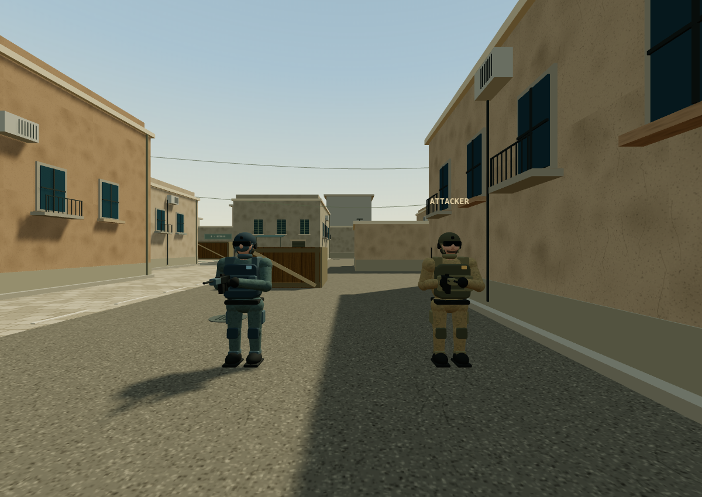

# SANDLINE 沙线 · 单机视觉升级版

这是可完全离线运行的单机战术射击游戏。无需 Node.js、服务器或联网。

## 下载与运行

1. 打开 [游戏包 ZIP](./dist/SANDLINE-Solo-v2.zip)，使用 GitHub 的 Download raw file 按钮下载。
2. 解压 ZIP，用电脑上的 Chrome、Edge 或 Firefox 打开“开始游戏.html”。
3. 点击“开始单机”。需要键盘、鼠标和支持 WebGL 的桌面浏览器。

也可单独下载 [游戏 HTML](./dist/SANDLINE-Solo-v2.html)，保存后直接在浏览器打开。

WASD 移动，鼠标瞄准，左键开火，右键开镜，R 换弹，B 购买，长按 E 安装或拆除，Esc 暂停。

首页可切换进攻／防守阵营与难度。你与 7 名机器人进行 4v4 爆破，先赢 5 回合获胜。

## 新版画面

原创游戏，借鉴经典战术射击机制；与 Valve 或 Counter-Strike 无关联。
